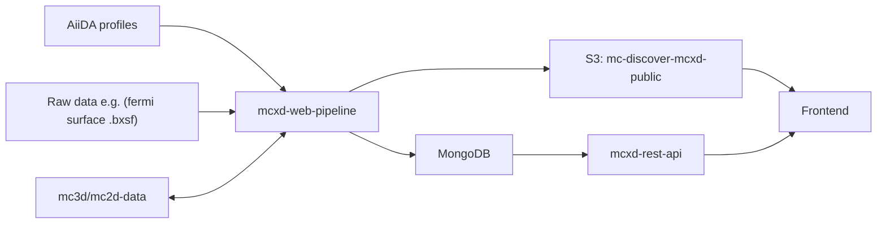

# Web pipeline for MC3D and MC2D

This repository contains

- `mcxd-web-pipeline` - pipeline (scripts) to start from AiiDA data, and custom json metadata to generate MCXD-specific metadata as raw json files, directly to MongoDB or to S3.
- `mc3d/mc2d-data` - extra metadata and intermediate json files for essential data.
- `mcxd-rest-api` - REST API to serve the MCXD data from MongoDB and the S3.

Overview/context:

